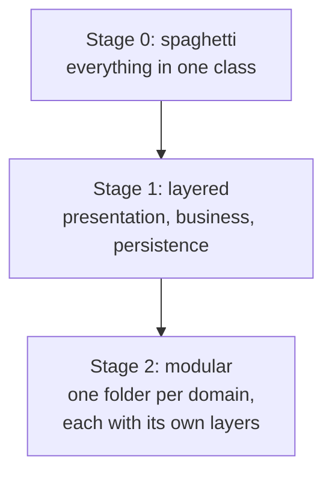
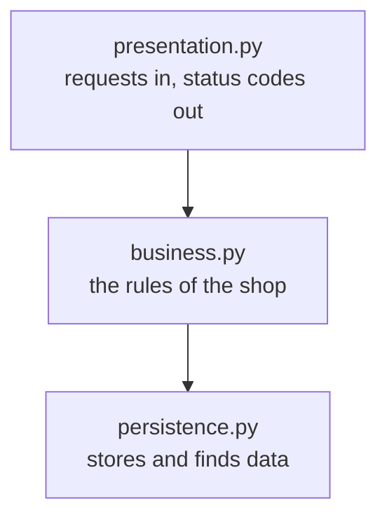
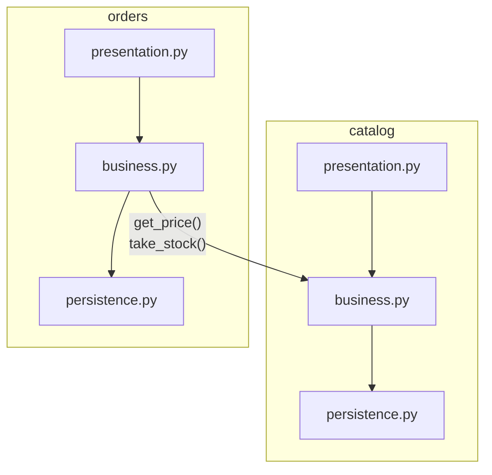

# Bookworm: from spaghetti code to a modular monolith

Exercise for class, 30-45 minutes. You only need Python and pytest (`pip install pytest`).

Bookworm is a tiny online bookshop: you can add books and place orders. You will reorganise its code twice **without changing what it does**:



## How it works: red to green

Each stage is a folder with two kinds of tests:

- `test_shop_behaviour.py` checks **what the shop does, seen from the outside**: adding books, prices, shipping, stock, errors. It is the same file in every stage. It passes from the start and must **keep passing after every change**. If it goes red, the refactoring broke the shop.
- `test_stepN_*.py` checks **how the code is organised**, one file per step. These tests **fail at the start**. A step is finished when its file is green.

Run the tests from inside the stage folder:

```bash
cd stage1_layered
pytest test_step1_persistence.py    # the step you are working on
pytest                              # everything
```

## The shop

The app answers requests with a status code and a body, like a web API:

```python
shop = create_app()
shop.add_book({"title": "Dune", "price_cents": 1500, "stock": 10})   # -> (201, {...book...})
shop.place_order({"book_id": 1, "quantity": 2})                       # -> (201, {...order...})
```

Rules: `subtotal = price x quantity`. Shipping is free from 5000 cents (50 euros), otherwise it costs 499 cents. An order takes the books out of stock. Errors: 400 invalid data, 404 not found, 409 not enough stock.

## Stage 0: the spaghetti code (5 min)

`stage0_spaghetti/app.py` works and `test_shop_behaviour.py` passes. But one class does everything: it checks the input, applies the shop rules and stores the data, all mixed together in the same methods. This is the code we are going to reorganise.

## Stage 1: layered (15-20 min)

Split the code into three layers. Each layer only uses the one below it.



Starting point in `stage1_layered/`: `presentation.py` still contains the whole stage 0 code. `persistence.py` and `business.py` only have empty functions marked `TODO`.

| Step | What to do | Test that must turn green |
|---|---|---|
| 1 | Fill in `persistence.py`: save and find books and orders. No rules here | `test_step1_persistence.py` |
| 2 | Fill in `business.py`: the input checks, the shipping rule and the stock rule, using `persistence.py` to store data. Raise an error when something is wrong | `test_step2_business.py` |
| 3 | Reduce `presentation.py` to calling `business.py` and turning its errors into status codes. It must not store data or contain shop rules | `test_step3_presentation.py` |

`test_shop_behaviour.py` must stay green after every step.

## Stage 2: modular (15-20 min)

The shop grows and there are now two teams, one for the catalogue and one for orders. In stage 1 they would both edit the same three files. Now the code is split by **domain**, and **each domain keeps its own three layers**:



The rules:
- Inside each domain: presentation → business → persistence.
- Between domains: orders may only use `catalog/business.py`. It never touches the catalog's persistence, so the books are only changed by the catalog.

Starting point in `stage2_modular/`: the shop still runs on the stage 1 layered code (`business.py`, `persistence.py`, `presentation.py`). The folders `catalog/` and `orders/` have their three layer files with empty functions marked `TODO`. `errors.py` is done.

| Step | What to do | Test that must turn green |
|---|---|---|
| 1 | Fill in the three files in `catalog/`, moving the book code from stage 1. Add `get_price()` and `take_stock()` to `catalog/business.py`: they are what other domains are allowed to use | `test_step1_catalog.py` |
| 2 | Fill in the three files in `orders/`, moving the order code from stage 1. For anything about books, call `get_price()` and `take_stock()` in the catalog | `test_step2_orders.py` |
| 3 | Make `app.py` build the shop from `catalog/` and `orders/`, then delete the old `business.py`, `persistence.py` and `presentation.py` | `test_step3_app.py` |

`test_shop_behaviour.py` must stay green after every step.

## Solution

The finished code is in the `solution` branch, with one commit per step. Each step is tagged (`stage1-step1` ... `stage2-step3`), so you can jump to any point:

```bash
git checkout stage1-step2               # the code right after stage 1, step 2
git diff main stage1-step1              # what step 1 of stage 1 changes
```
